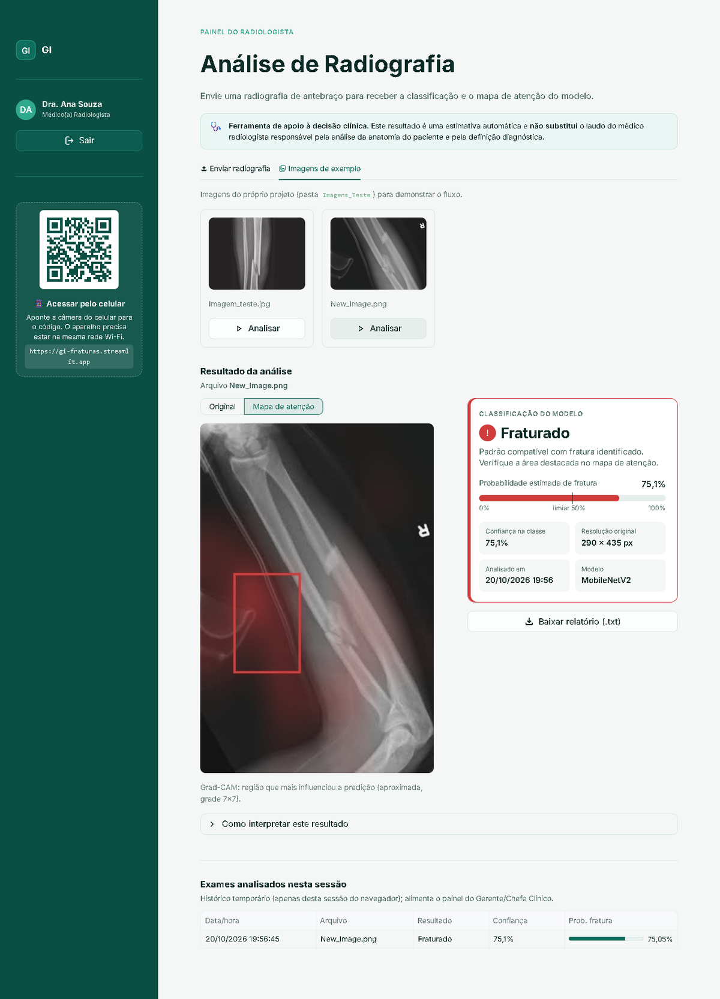
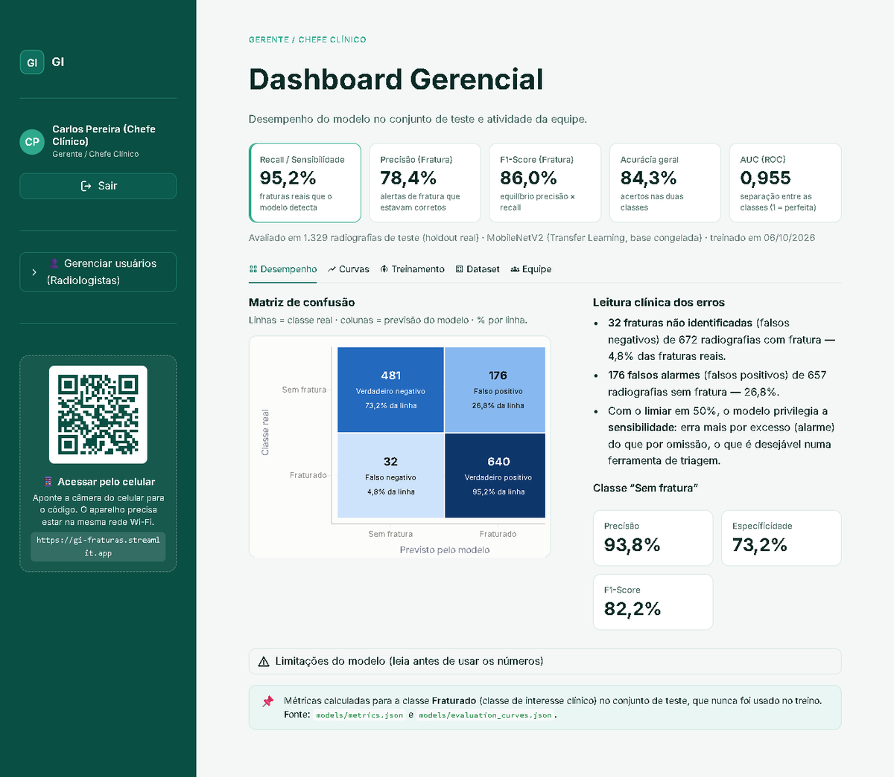
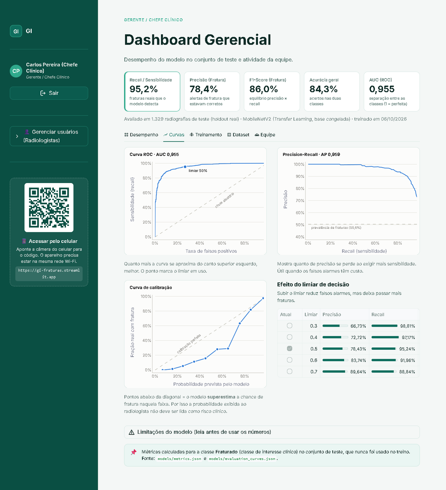
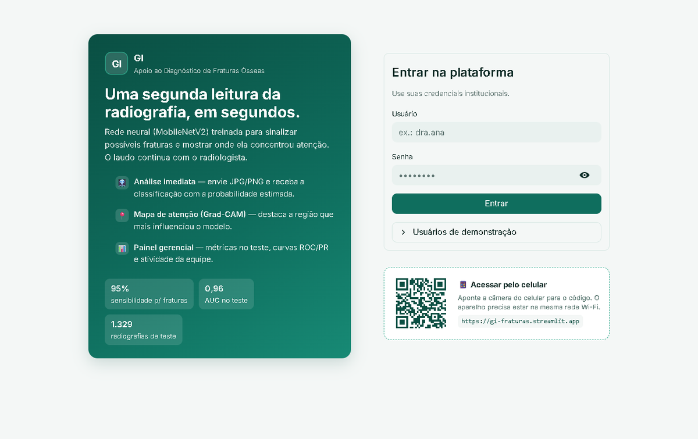
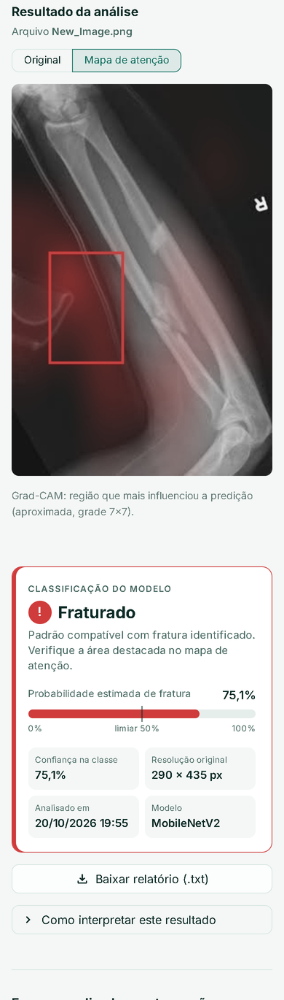

# GI — Detecção de Fraturas Ósseas em Radiografias

Projeto acadêmico de Data Science desenvolvido pelo **Grupo GI**.

Classificação binária de radiografias de antebraço (**fraturado / sem fratura**) com redes neurais
convolucionais, e um app em Streamlit pensado como ferramenta de apoio ao médico radiologista.
O app mostra a classificação, a probabilidade estimada e um mapa de atenção (Grad-CAM) indicando a
região da imagem que mais pesou na decisão do modelo.

**App online:** https://gi-fraturas.streamlit.app

> Projeto acadêmico. O modelo não passou por validação clínica e não deve ser usado para diagnóstico.

<p align="center">
  
</p>

## Resultados

Modelo final: **MobileNetV2 com Transfer Learning** (base congelada, pré-treinada no ImageNet).
Avaliação em um conjunto de teste separado (1.329 radiografias) que não foi usado no treino:

| Métrica (classe Fraturado) | Valor |
| --- | ---: |
| Recall / Sensibilidade | 95,2% |
| Precisão | 78,4% |
| F1-Score | 86,0% |
| Acurácia | 84,3% |
| AUC (ROC) | 0,955 |

Com o limiar em 0,5 o modelo deixou passar 32 das 672 fraturas do teste e gerou 176 falsos alarmes
em 657 imagens sem fratura. Para uma ferramenta de triagem preferimos esse equilíbrio (errar mais
por excesso do que por omissão). A tabela de efeito do limiar no painel gerencial mostra como isso
muda com outros valores.

## O app

O acesso é separado por perfil:

- **Radiologista**: envia a radiografia (JPG/PNG) e recebe a classificação, a probabilidade de fratura
  com o limiar de decisão, o mapa de atenção Grad-CAM e um relatório em `.txt`. Resultados perto do
  limiar aparecem sinalizados como limítrofes.
- **Gerente / Chefe Clínico**: painel com as métricas do modelo, matriz de confusão, curvas ROC,
  Precision-Recall e de calibração, histórico de treino, distribuição do dataset e a atividade da
  equipe na sessão. Também cadastra e remove contas de radiologistas.

O layout funciona no celular. Rodando localmente, a tela de login mostra um QR code com o endereço
do app na rede, assim dá para abrir no celular conectado ao mesmo Wi-Fi.

| Painel gerencial | Curvas de avaliação |
| --- | --- |
|  |  |

| Login (desktop) | Celular |
| --- | --- |
|  |  |

Usuários de demonstração:

| Perfil | Usuário | Senha |
| --- | --- | --- |
| Radiologista | `dra.ana` | `raiox2026` |
| Gerente / Chefe Clínico | `gerente.carlos` | `gestao2026` |

## Como rodar

Requer Python 3.10+.

```bash
git clone https://github.com/Lira-one/gi-fraturas.git
cd gi-fraturas
pip install -r streamlit_app/requirements.txt
streamlit run streamlit_app/app.py
```

O modelo treinado já está em `models/`, então não é preciso treinar para usar o app.

### Treinar de novo

O dataset não está no repositório por causa do tamanho. Coloque as imagens em
`DataSet Raio-x/dataset/` seguindo a estrutura:

```
DataSet Raio-x/dataset/
├── train/
│   ├── fractured/
│   └── not fractured/
└── validation/
    ├── fractured/
    └── not fractured/
```

Depois, a partir da raiz do projeto:

```bash
python training/train_model.py       # treina e salva models/fracture_cnn_mobilenetv2.keras + metrics.json
python training/evaluate_curves.py   # gera as curvas ROC / PR / calibração usadas no painel
```

Como a pasta `test/` original estava vazia, 15% de `train/` é separado (estratificado por classe,
semente fixa) para servir de teste. A pasta `validation/` é usada só no Early Stopping.

## Estrutura

```
├── Laboratório/
│   └── Deteccao_Fraturas.ipynb   # notebook de estudo (Colab): CNN do zero vs. MobileNetV2
├── training/
│   ├── dataset_utils.py          # constantes e carregamento do dataset (compartilhado com o app)
│   ├── train_model.py            # treino do MobileNetV2
│   └── evaluate_curves.py        # curvas de avaliação no conjunto de teste
├── models/                       # modelo treinado e métricas
├── streamlit_app/
│   ├── app.py                    # login e roteamento por perfil
│   ├── pages_logic/              # telas do radiologista e do gerente
│   ├── gradcam.py                # mapa de atenção
│   └── ...
├── Imagens_Teste/                # imagens de exemplo usadas no app
├── Documentação/                 # documento do projeto e apresentação
└── Artigo_Deteccao_Fraturas_Osseas.docx
```

## Metodologia

O notebook em `Laboratório/` documenta todo o processo: análise do dataset, pré-processamento
(224×224, normalização dentro do modelo), data augmentation leve (flip horizontal, rotação e zoom),
uma CNN construída do zero como baseline e a comparação com o MobileNetV2 via Transfer Learning,
além da análise dos erros (falsos negativos e falsos positivos). O MobileNetV2 foi o modelo levado
para o app.

## Limitações

- O desempenho medido vale para imagens parecidas com as do dataset. Radiografias de outros
  equipamentos, ossos ou incidências podem ter resultado bem pior.
- A probabilidade exibida não é calibrada: na faixa intermediária o modelo superestima a chance de
  fratura (ver curva de calibração no painel).
- O Grad-CAM tem baixa resolução (grade 7×7) e às vezes destaca regiões fora da linha de fratura.
  Ele mostra para onde o modelo olhou, não onde a fratura está.
- Não houve validação com especialistas nem teste em dados externos.

## Próximos passos

- Classificar o tipo de fratura (transversa, longitudinal, oblíqua, espiral, cominutiva etc.).
- Fine-tuning das camadas finais do MobileNetV2 e testes com EfficientNet.
- Avaliação em um dataset externo.

## Autoria

Desenvolvido pelo **Grupo GI** como projeto acadêmico.
